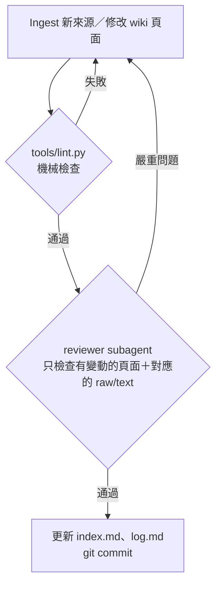
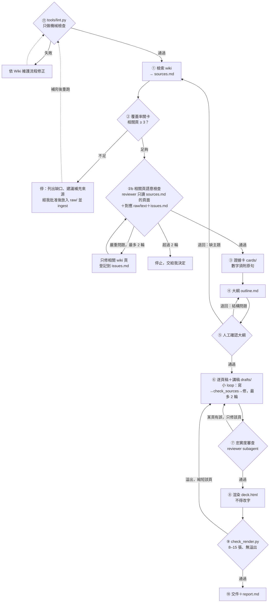
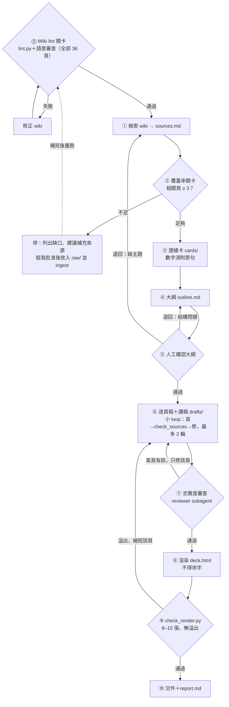

# RAG Wiki × 教學 HTML 簡報

本專案依 Karpathy 的 LLM Wiki 構想，以「RAG（檢索增強生成）」為主題建立知識庫（`wiki/`），
再透過 graph workflow（`/topic-slides`）只使用 wiki 內容產生教學型 HTML 簡報。

- 原始資料：`raw/`（7 份論文與技術文章）
- Wiki：`wiki/`（入口為 [wiki/index.md](wiki/index.md)）
- Wiki 規則：[AGENTS.md](AGENTS.md)
- 簡報 workflow 定義：`.claude/commands/topic-slides.md`
- 執行紀錄：`output/<主題>/`（lint 紀錄、issues.md、證據卡、大綱、逐頁稿、deck.html、report.md）

圖例：菱形＝檢查關卡；方框＝AI 工作節點；虛線＝需要人工介入的路線。

---

## Workflow v2（目前版本）

v2 把 wiki 的語意檢查拆成兩處：**ingest 時**只檢查有變動的頁面；**做簡報時**只檢查和主題相關的頁面。

### A. Wiki 維護流程（每次 ingest 或修改 wiki 時）

### B. 簡報流程（`/topic-slides <主題>`）

### v2 的嚴重度規則（寫死，不讓 reviewer 每輪自行判斷）

- **嚴重**只有兩種：
  1. 數字或結論和引用的 raw 原文不符，或講反了；
  2. 和 wiki 另一頁直接矛盾，而且沒有 ⚠️ 標註。
- 無法確定的一律列為**輕微**。
- 已登記在 `issues.md` 的問題，嚴重度不得改變；reviewer 只回報新問題，以及舊問題是否仍然存在。

---

## Workflow v1（已淘汰）

## 為什麼從 v1 改成 v2

v1 在第一次實際執行時，⓪ 連續退回 3 次，達到上限，一直沒能進入 ① 檢索
（紀錄見 `output/what-is-rag/lint-round1.md`、`lint-round2.md`、`lint.md`）。

| v1 的問題 | 實際發生的情況 | v2 的改法 |
|---|---|---|
| 語意檢查範圍太大 | 每輪重讀全部 36 頁，每次抽到不同的問題，關卡無法收斂 | ⓪ 只做機械檢查；語意檢查只看和主題相關的頁面（②b） |
| 嚴重度標準不固定 | 同一個問題（Self-RAG 的限定條件）第 1、2 輪列為輕微，第 3 輪變成嚴重 | 嚴重度規則寫死；已登記的問題不得改變嚴重度 |
| 問題沒有追蹤 | 只修當輪列出的問題，同類問題（⚠️ 未同步）三輪都被提到 | 用 `issues.md` 給每個問題固定編號和狀態，並依類別整批修正 |
| reviewer 無法核對原文 | 「需要更多資料」的項目永遠無法解決 | reviewer 可以讀相關頁對應的 `raw/text/` |
| 錯誤太晚才被抓到 | 錯誤是在 ingest 時產生的（拿掉限定條件、⚠️ 沒同步），到做簡報前才被發現 | 檢查往前移：每次 ingest 或修改後，只檢查有變動的頁面 |
